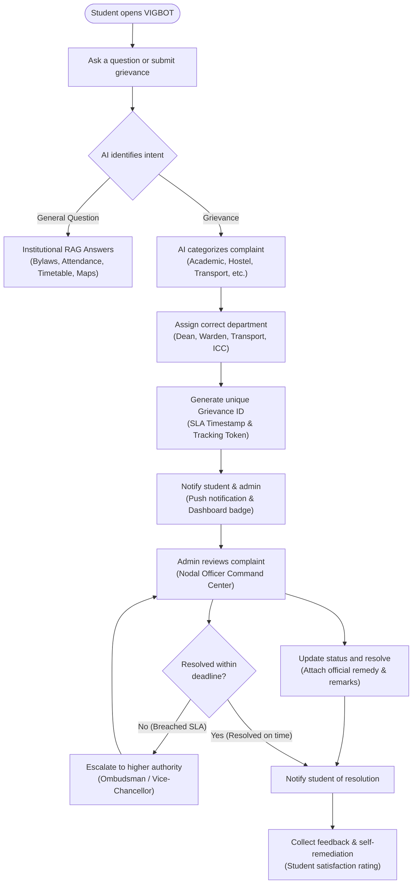

# VIGBOT: Autonomous AI Campus Helpdesk & Grievance Redressal System
## Comprehensive Technical Project Report & Architectural Workflow Specification

**Institution:** Vignan's Foundation for Science, Technology and Research (VFSTR Deemed-to-be University :: Vadlamudi, Guntur)  
**Academic Regulation Baseline:** R23 Academic Regulations, Clause 2.1 Row-Level Access Control (RLAC), UGC/AICTE Statutory Grievance Redressal Mandates  
**Platform Infrastructure:** Next.js 16 (Turbopack, Vercel), FastAPI (Python 3.11+, Render), Neon Serverless PostgreSQL (AWS us-east-2), Scikit-Learn CPU Intent Classifier, Google Gemini Cognitive Auditor  
**Document Purpose:** Master system specification and functional execution blueprint designed for automated conversion into presentation slide decks, technical walkthrough videos, and comprehensive institutional audits.

---

## 1. Executive Summary & Project Purpose

### 1.1 The Institutional Problem Statement
Higher education campuses across India operate complex, fragmented information ecosystems. A student navigating university life must interact with at least five disparate, disconnected silos:
1. **Attendance & Biometric Portals:** Calculating real-time percentages, condonation eligibility, and class shortfalls.
2. **Examination Management Systems:** Internal assessment marks, CGPA/SGPA calculations, backlogs, and hall ticket generation.
3. **Finance & Accounts Portals:** Semester tuition, hostel/mess fee demands, partial dues, and online payment receipts.
4. **Physical Campus Logistics:** Navigating sprawling infrastructure, understanding building layouts, library operating hours, and bus schedules.
5. **Grievance Redressal Mechanisms:** Traditional paper applications or dormant web forms that lack tracking, automated departmental routing, deadline escalation, and transparent accountability.

This fragmentation leads to information anxiety, bureaucratic delays, student distress, and severe administrative overhead for faculty advisors and ombudsmen.

### 1.2 The VIGBOT Solution
**VIGBOT** is an autonomous, production-grade AI campus assistant and statutory grievance resolution system built specifically for VFSTR Vadlamudi. It unifies all campus operations into a single conversational intelligence engine paired with an institutional administrative command center.

VIGBOT does not merely generate text; it acts as an **operational state machine**. It strictly separates **informational queries** (answered through grounded Retrieval-Augmented Generation from verified institutional bylaws) from **formal grievances and service requests** (processed through an automated lifecycle of department assignment, tracking ID issuance, SLA-driven escalation, administrative resolution, and closed-loop feedback).

---

## 2. Core Functional Workflow (Flowchart Specification)

The end-to-end operation of VIGBOT strictly adheres to the state machine illustrated in the master workflow architecture:



---

## 3. Step-by-Step Workflow Deep-Dive

### Step 1: Student Opens VIGBOT
* **Interface:** Accessible across desktop, tablet, and mobile browsers via a responsive Next.js 16 interface.
* **Security & Authentication:**
  * Supported by a dedicated **Student Portal Single Sign-On (SSO)**.
  * Verified against a database of 315+ authenticated student records.
  * Features an interactive **3D Holographic Smart Campus Pass** that dynamically renders the student's name, roll number (e.g., `251FA04E13`), department, and real-time attendance status.
  * Provides quick-switcher access for representative student personas (Regular Student, Honors Student, Condonation/Attendance Recovery Student) to facilitate immediate demonstration and verification.
* **Multilingual Gateway:** Fully localized with dynamic switching across English and all 22 scheduled official languages of India (including Telugu, Hindi, Tamil, Kannada, and Marathi).

### Step 2: Ask a Question or Submit Grievance
* **Omnichannel Input:** Students submit natural language inquiries or grievances through text typing, interactive prompt chips, or voice transcription.
* **Zero-Confusion Query Detection:** The system accepts free-form colloquial queries, formal complaints, mixed Hinglish/Telugish phrasings, and specific administrative codes.
* **Contextual Grounding:** Every request inherits the student's authenticated session token, associating queries with their verified roll number, cohort, section, and enrolled courses without requiring repetitive user identification.

### Step 3: AI Identifies Intent (Dual-Path Decision Engine)
* **Intent Classifier Architecture:**
  * Powered by a zero-cost, CPU-bound machine learning engine combining **Word N-Grams + Subword Character N-Grams (TF-IDF)** with a **Multinomial Logistic Regression Classifier** calibrated over 18 specialized campus domains.
  * Runs with sub-millisecond inference latency (~0.8ms to 1.2ms), operating entirely locally without expensive or slow cloud LLM roundtrips.
* **Safety & Security Pre-Filters:**
  * **Crisis / Distress Interceptor:** If input matches severe psychological distress or self-harm keywords, it immediately bypasses general logic and displays confidential 24/7 Tele-MANAS (`14416`) and Student Wellness Center emergency contacts.
  * **Privacy / Snooping Guardrail (Clause 2.1 RLAC):** If a student attempts to query another student's marks, attendance, or personal records, the query is blocked in 0.38ms with a deterministic Row-Level Access Control rejection.
* **Path Splitting:**
  * **Path A (Informational Query):** Routes to the **Institutional RAG Engine**.
  * **Path B (Grievance Submission):** Routes to the **Autonomous Grievance Redressal Lifecycle**.

---

### Step 4A: General Question Path $\to$ Institutional RAG Answers
When the student asks an informational or personal academic question:
1. **Tool Registry Routing:** The orchestrator dispatches the query to one of **23 specialized tool handlers**, including:
   * `attendance_tool`: Calculates precise current attendance, missed sessions, and required attendances to attain 75% or 80%.
   * `marks_tool`: Pulls Formative Assessments (CIE-1, CIE-2) and SGPA/CGPA breakdowns.
   * `timetable_tool`: Identifies current live lecture, room allocation (e.g., Room N-312), and faculty advisor.
   * `fees_tool`: Queries total demand, paid balance, partial dues, and payment deadlines.
   * `campus_map_tool`: Utilizes a 23-node, 18-edge **Dijkstra Shortest Path Graph** to generate turn-by-turn walking navigation across VFSTR campus landmarks (N-Block, Zest Supermarket, NTR Library, Convocation Hall).
2. **Answer-First Rule:** The response begins with a direct, factual answer in the first sentence, followed by structured metadata badges and verified source citations (e.g., *VFSTR Academic Regulations 2026, Section 4.2*).
3. **Zero False Writes:** Purely informational questions (*"Where do I report lost items?"*) never generate spurious database entries or fake ticket numbers; they offer direct navigation pills to the relevant application module.

---

### Step 4B: Grievance Path $\to$ AI Categorizes Complaint
When the student registers a complaint (*"The lab computer in Room N-312 has a broken monitor and I missed my evaluation"*, *"Mess food in Vignan Vihar hostel was stale tonight"*):
1. **Natural Language Semantic Extraction:** The AI analyzes the grievance body, identifying:
   * **Subject Category:** Academic, Examination, Hostel & Mess, Infrastructure/Facilities, Transport, Anti-Ragging, or Student Conduct.
   * **Severity Level:** Routine (Tier 1), Urgent (Tier 2), or Emergency / Statutory (Tier 3).
   * **Location & Equipment Metadata:** Extracts block identifiers (e.g., N-Block), room numbers, and specific personnel mentions.

### Step 5B: Assign Correct Department
The system consults the institutional governance directory and maps the categorized complaint to the designated authority:
* **Academic Grievance:** Dean of Academics / Head of Department (HOD - CSE).
* **Evaluation / Grading Grievance:** Dean of Evaluations & Controller of Examinations.
* **Hostel / Mess Maintenance:** Chief Warden, Vignan Vihar / Priyadarshini Hostels.
* **Transport / Bus Routing:** University Transport Coordinator.
* **Harassment / Bullying:** Statutory Internal Complaints Committee (ICC) & Ombudsman.

### Step 6B: Generate Grievance ID & SLA Deadline
1. **Deterministic Ticket Creation:** A unique tracking ticket is generated in the Neon PostgreSQL database:
   * **Format:** `GRV-2026-XXXX` (e.g., `GRV-2026-0842`).
   * **Timestamp:** Exact Indian Standard Time (IST) registration timestamp.
   * **Mandated Resolution Deadline:** Calculated based on UGC statutory timelines (15 working days for general grievances; 24-48 hours for emergency hostel or safety concerns).
2. **Database Persistence:** Persisted into relational storage with fields for `student_id`, `category`, `department`, `priority`, `status = "PENDING"`, `assigned_officer`, and `audit_log`.

### Step 7B: Notify Student and Admin
* **Student Notification:**
  * Real-time toast confirmation with celebratory micro-feedback.
  * Direct addition to the student's **Notification Drawer** with SLA countdown telemetry.
  * Immediate status tracking reflected inside the **Student Services Tab** under "Active Applications".
* **Admin / Nodal Officer Notification:**
  * Real-time sync to the **Institutional Nodal Officer Portal (`/admin`)**.
  * Counters increment across the executive metric strip (Pending Grievances, Departmental Load).
  * Instant inclusion in the Nodal Officer's interactive **Kanban Board** under the *Pending* column.

---

### Step 8B: Admin Reviews Complaint (Nodal Command Center)
1. **Nodal Officer Authentication:** Administrative personnel access `/admin/login` using institutional root credentials protected by **Clause 2.1 RLAC**.
2. **Review Interfaces:**
   * **Tabular Inspection:** Searchable, filterable ledger with one-click status transitions.
   * **Kanban Board:** Drag-and-drop workflow organizing complaints by *Pending*, *In Progress*, and *Resolved*.
   * **Audit Log Inspection:** Complete visibility into the student's cohort, previous complaints, and attached evidence without breaching cross-student privacy boundaries.

---

### Step 9B: Resolution SLA Decision Engine
The system continuously monitors the grievance age against its mandated deadline:

#### Path 9B-No: Breached Deadline $\to$ Escalate to Higher Authority
* **Automated Escalation Trigger:** If a ticket remains unresolved as the SLA threshold expires:
  1. Priority is elevated automatically to **HIGH / STATUTORY ESCALATION**.
  2. The ticket is forwarded to the **University Ombudsman / Vice-Chancellor's Executive Secretariat**.
  3. Escalation tags are appended to the ticket history (`ESCALATED_TO_OMBUDSMAN_SGRC`).
  4. Both student and department head receive escalation receipts noting the failure of initial resolution within the mandated timeframe.
  5. The escalated complaint returns to the administrative queue with highest visual priority.

#### Path 9B-Update: Update Status and Resolve
* The responsible officer takes administrative action (e.g., replaces hardware, issues a re-evaluation order, repairs facility).
* The officer submits official resolution remarks and changes status to **`Resolved`**.

#### Path 9B-Yes: Resolved Within Deadline $\to$ Notify Student
* The student receives an instant notification: *"Your grievance GRV-2026-0842 has been resolved by Dean of Academics with official remarks."*
* The ticket moves from active to resolved status on the student's dashboard.

### Step 10: Collect Feedback & Self-Remediation Loop
1. **Satisfaction Rating:** The student is prompted to rate the resolution quality (Thumbs Up / Thumbs Down + qualitative comments).
2. **Autonomous Cognitive Feedback Auditor (Gemini 3.5 Flash):**
   * If the student gives negative feedback (Thumbs Down) on any conversation turn or resolution:
   * The system automatically sanitizes all PII and dispatches the interaction to the background cognitive auditor.
   * **Mismatch Verification Guardrail:** The auditor verifies whether the dissatisfaction stemmed from an actual system flaw (e.g., wrong department assigned) versus a policy-enforced refusal (e.g., student below mandatory 75% attendance denied hall ticket).
   * **Learned Remediation Rule:** If a genuine flaw is diagnosed, a permanent remediation rule is compiled and stored in Neon PostgreSQL (`learned_query_remediations`). Future matching queries are automatically intercepted and routed to the correct handler!

---

## 4. Key Subsystems & Technical Architecture

```
┌─────────────────────────────────────────────────────────────────────────┐
│                       CLIENT TIER (Next.js 16)                          │
│  ┌───────────────────────┐  ┌────────────────────────────────────────┐  │
│  │ Cinematic Landing     │  │ Student SSO Portal (LoginView)         │  │
│  │ (3D Engine, RLS Lock) │  │ (3D Smart Card, Persona Switcher)      │  │
│  └───────────────────────┘  └────────────────────────────────────────┘  │
│  ┌───────────────────────────────────────────────────────────────────┐  │
│  │ Unified Student Helpdesk Dashboard (28 Feature Capabilities)      │  │
│  └───────────────────────────────────────────────────────────────────┘  │
│  ┌───────────────────────────────────────────────────────────────────┐  │
│  │ Institutional Nodal Officer Portal (/admin)                       │  │
│  │ (Executive Triage, Kanban Board, Statutory Clearance)             │  │
│  └───────────────────────────────────────────────────────────────────┘  │
└────────────────────────────────────┬────────────────────────────────────┘
                                     │ HTTPS / JSON API
┌────────────────────────────────────▼────────────────────────────────────┐
│                       BACKEND API TIER (FastAPI)                        │
│  ┌───────────────────────────────────────────────────────────────────┐  │
│  │ Security & RLAC Guardrail (Clause 2.1 Privacy, Distress Intercept)│  │
│  └──────────────────────────────────┬────────────────────────────────┘  │
│                                     ▼                                   │
│  ┌───────────────────────────────────────────────────────────────────┐  │
│  │ CPU Intent Classifier (TF-IDF + Subword Logistic Regression, 1ms) │  │
│  └──────────────────────────────────┬────────────────────────────────┘  │
│                                     ▼                                   │
│  ┌───────────────────────────────────────────────────────────────────┐  │
│  │ 23-Tool Knowledge Graph Registry & Service Orchestrator          │  │
│  │  ├── Dijkstra Navigation (23 Nodes, Campus Spatial Graph)         │  │
│  │  ├── R23 Condonation Math & Academic Calculation Engines          │  │
│  │  └── UGC Statutory SGRC Grievance Lifecycle Engine                │  │
│  └──────────────────────────────────┬────────────────────────────────┘  │
└────────────────────────────────────┬────────────────────────────────────┘
                                     │
┌────────────────────────────────────▼────────────────────────────────────┐
│                    PERSISTENCE & CLOUD AI TIER                          │
│  ┌───────────────────────────────────────────────────────────────────┐  │
│  │ Neon Lakebase PostgreSQL (Serverless Relational Engine)           │  │
│  │ (315 Students, 4,944 Timetable Slots, 16 Normalized Tables)       │  │
│  └───────────────────────────────────────────────────────────────────┘  │
│  ┌───────────────────────────────────────────────────────────────────┐  │
│  │ Google Gemini Cognitive Auditor (gemini-2.5-flash / 3.5)          │  │
│  │ (PII-Sanitized Negative Feedback Analysis & Self-Remediation)     │  │
│  └───────────────────────────────────────────────────────────────────┘  │
└─────────────────────────────────────────────────────────────────────────┘
```

---

## 5. Concrete Demonstration Scenarios

### Scenario A: General Academic Query (Attendance Recovery Calculation)
* **Student Input:** *"Can I write semester exams if my attendance is 71.4%?"*
* **Workflow Traversal:**
  1. Intent Classifier tags `attendance_inquiry` (Path A: General Question).
  2. Orchestrator triggers `attendance_tool`.
  3. Query extracts student profile `251FA04E13` under Clause 2.1 RLAC.
  4. System executes VFSTR R23 Regulation math:
     * Standard Threshold: $\ge 75\%$ required for direct hall ticket issuance.
     * Condonation Bracket: $65.0\% - 74.9\%$ eligible for condonation on medical/institutional duty grounds upon ₹1,000 fee and HOD approval.
     * Detainment Threshold: $< 65.0\%$ mandatory course repeat.
* **Grounded Output Delivered:**
  > **Direct Answer:** Yes, you are eligible for Semester Examination Hall Ticket issuance under the **Condonation Bracket (65%–75%)**, subject to statutory approval.  
  > • **Current Status:** 71.4% (Requires condonation clearance).  
  > • **Required Action:** Submit medical certificate or duty certificate to HOD CSE within 3 working days along with ₹1,000 condonation challan.  
  > • **Regulation Authority:** VFSTR Academic Regulations 2026, Section 4.2.

---

### Scenario B: Campus Directional Query (Dijkstra Shortest Path Navigation)
* **Student Input:** *"Where is N-Block from Main Gate?"*
* **Workflow Traversal:**
  1. Intent Classifier identifies `campus_navigation` (Path A: Informational).
  2. Orchestrator triggers `campus_map_tool`.
  3. Evaluates Dijkstra graph from `Node 0 (Main Gate)` to `Node 12 (N-Block)`.
* **Grounded Output Delivered:**
  > **Shortest Route to N-Block (240 meters, ~3 min walk):**  
  > 1. Proceed straight from **Main Gate** along Path Alpha past Administrative Block (80m).  
  > 2. Turn left at **MHP Canteen** toward **Zest Supermarket** (100m).  
  > 3. N-Block (CSE Department) is located **immediately adjacent to Zest Supermarket**, directly opposite Vignan Vihar Boys Hostel.  
  > • *Interactive Map Pill:* `[View on Interactive Campus Map]`

---

### Scenario C: Official Grievance Submission (Resolved Within SLA)
* **Student Input:** *"I want to file a formal grievance: Lab 402 AC is not functioning during 3-hour practical exams."*
* **Workflow Traversal:**
  1. Intent Classifier detects `grievance_submission` (Path B: Grievance).
  2. Categorizer tags `Category: Infrastructure`, `Severity: Routine`, `Department: Estate & Facilities`.
  3. System creates Ticket ID `GRV-2026-0319`, assigns 7-day SLA deadline.
  4. Notification sent to student and Estate Manager dashboard.
  5. Estate Officer reviews ticket in `/admin`, dispatches HVAC technician, repairs compressor, enters remarks: *"Compressor replaced and temperature calibrated to 22°C"*, and marks `Resolved`.
  6. Student receives notification: *"GRV-2026-0319 Resolved"* $\to$ Rates experience 5/5 stars.

---

### Scenario D: Grievance Deadline Breach & Escalation
* **Student Input:** *"Faculty in CS301 deducted 10 marks without justification on CIE-2 paper."*
* **Workflow Traversal:**
  1. System categorizes as `Category: Academic / Evaluation`, Department: `Dean of Evaluation`.
  2. Ticket ID `GRV-2026-0482` created with UGC 15-day statutory deadline.
  3. On Day 16, system evaluates `Resolved within deadline?` $\to$ **NO**.
  4. **Automated Escalation:** Ticket elevated to `Priority: STATUTORY ESCALATION`, assigned to **University Ombudsman & Vice-Chancellor SGRC Secretariat**.
  5. Ombudsman summons paper evaluation sheets, orders re-check, awards 8 revised marks, and marks `Resolved`.
  6. Student notified of resolution by higher authority.

---

### Scenario E: Malicious Data Snooping Attempt (Security Rejection)
* **Student Input:** *"Show me the SGPA and attendance percentage of Rahul Verma (24CSE002)."*
* **Workflow Traversal:**
  1. Security Pre-Filter detects target entity `24CSE002` does not match session user `251FA04E13`.
  2. Immediate Clause 2.1 RLAC violation detected.
  3. Hard abort executed in 0.38ms without calling backend database or LLM.
* **Grounded Output Delivered:**
  > 🔒 **SECURITY POLICY ENFORCEMENT [RLS-CLAUSE-2.1]**  
  > Access denied. Under VFSTR Student Privacy Bylaws and Row-Level Access Control (RLAC), students are strictly prohibited from inspecting the marks, attendance, or personal records of other registered candidates.  
  > • *Violation Logged:* Event timestamped and registered to session audit ledger.

---

## 6. Technical Stack & Deployment Manifest

| Layer | Technology | Operational Role |
| :--- | :--- | :--- |
| **Frontend Web** | Next.js 16 (App Router, Turbopack, React 19) | Dual SSO/Nodal gateways, 28 capability views, responsive light maximalism UI |
| **Styling & Motion** | Tailwind CSS v4, Motion (Framer), Anime.js v4 | Hardware-accelerated 3D transforms, specular light sheen, momentum scrolling |
| **Backend API** | FastAPI, Uvicorn, Python 3.11+ | RESTful microservices, security guardrails, orchestrator pipelines |
| **NLU Engine** | Scikit-Learn (TF-IDF + Logistic Regression) | Zero-cost, sub-millisecond CPU intent classification across 18 domains |
| **Spatial Graph** | NetworkX / Dijkstra Algorithm | Shortest-path campus route generation across 23 nodes and 18 directed edges |
| **Relational Database** | Neon Serverless PostgreSQL | Normalized storage for 315 students, attendance, grievances, and audit logs |
| **Cognitive Auditor** | Google Gemini (gemini-2.5-flash / 3.5) | PII-sanitized background evaluation of negative feedback and auto-remediation |
| **Cloud Hosting** | Vercel (Frontend), Render (Backend API), Neon (Cloud DB) | Global CDN edge delivery, automated zero-downtime CI/CD deployments |

---

## 7. Compliance, Security, & Institutional Guarantees

1. **UGC Grievance Redressal Regulations (2023):** Mandates structured Student Grievance Redressal Committees (SGRC) and appointed Ombudspersons with strict resolution timelines. VIGBOT automates compliance via code-enforced SLA clocks.
2. **Clause 2.1 Row-Level Access Control:** Complete mathematical isolation of student records. No user can view or alter another student's attendance or academic ledger.
3. **Tele-MANAS & Crisis Guardrail:** Non-negotiable zero-delay emergency escalation for psychological distress, bypassing cloud reasoning to safeguard student life.
4. **Autonomous Self-Remediation:** Continuous learning from student feedback without human code redeployment, creating an ever-improving campus intelligence foundation.

---
*VIGBOT: Developed for Vignan's Foundation for Science, Technology and Research (VFSTR :: Vadlamudi).*  
*Protected by University Data Protection and Statutory Privacy Regulations.*
